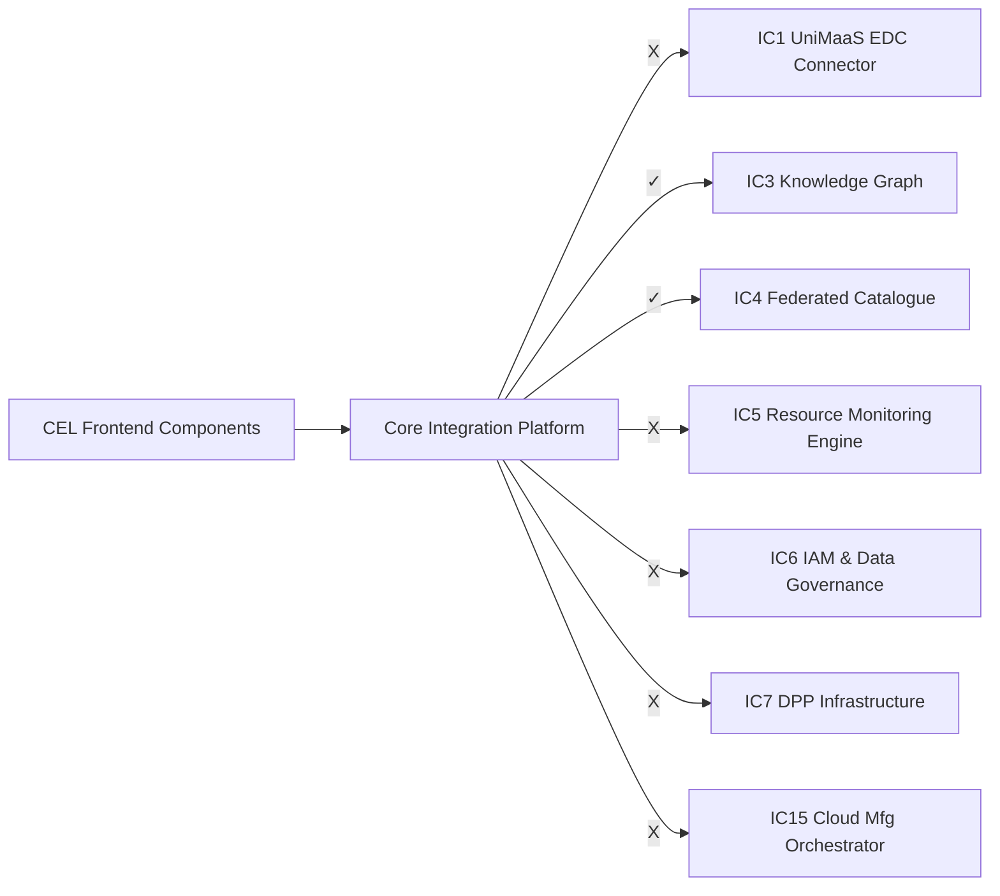

# Core Integration Platform Integration Tracking

This file tracks IC17 interfaces, current design status, and missing inputs.

## Integration Landscape

## Status Matrix

| Component                      | Partner | Frontend capability                                                      | Readiness | Swagger docs                                                | Notes                                                                                              |
| ------------------------------ | ------- | ------------------------------------------------------------------------ | --------- | ----------------------------------------------------------- | -------------------------------------------------------------------------------------------------- |
| IC1 UniMaaS EDC Connector      | FLM     | Dataset registration and transfer initiation from search/provider flows  | Not ready |                                                             |                                                                                                    |
| IC3 Knowledge Graph            | FLM     | Customer search and semantic query support                               | Partial   | [swagger](https://unimaas-project-eu.github.io/central-kg/) | Central KG routes and query parameters are known                                                   |
| IC4 Federated Catalogue        | FLM     | Catalogue search/read for customer search                                | Partial   | [openapi](../../federated-catalog/docs/openapi.json)        | Access-API route skeleton only. Request forwarding is pending. See contract notes below.          |
| IC5 Resource Monitoring Engine | NTUA    | Infrastructure status and monitoring views                               | Not ready |                                                             |                                                                                                    |
| IC6 IAM & Data Governance      | ODINS   | Registration, identity validation, role assignment, authorization checks | Not ready |                                                             | Expected IAM/governance schemas are known, but final OpenAPI and token flow are missing.           |
| IC7 DPP Infrastructure         | ODINS   | DPP product lifecycle read/manage views                                  | Not ready |                                                             |                                                                                                    |
| IC15 Cloud Mfg Orchestrator    | NTUA    | Order and workflow status views                                          | Partial   |                                                             | Argo/Kubernetes workflow status is only a starting assumption. Final IC15 API contract is missing. |

## IC4 OpenAPI contract notes

`GET /federated-catalogue` and `POST /federated-catalogue/datasets` mirror `federated-catalog/docs/openapi.json`. Responses use the IC17 envelope (`source_component`, `source_status`, `data`). `data` is a placeholder `{filters, datasets: []}` and no request is forwarded. The same maturity as IC3: routes and validation exist, backend connectivity does not.

The supplied OpenAPI is kept as the request contract. These inconsistencies are recorded here and are not resolved by widening IC17 validation:

- `POST /datasets` description says "fitlers". The IC17 operation description preserves that wording.
- `GET /` success schema is an empty object. IC17 returns `FederatedCatalogueResponse` instead of proxying that body.
- `DatasetFilters` declares `@id`, `dcat:dataset`, and `dspace:participantId` as arrays of strings. The schema example puts objects inside `dcat:dataset`, so that example does not validate. IC17 follows the declared string arrays.
- The `POST /datasets` 200 example shows `dcat:dataset` as an object. Response items are free-form objects (`additionalProperties: true`), so that example fits the response schema and still disagrees with the request property type.
- `additionalProperties` allows an array, an object, or a string. The array branch has an empty `items` schema, so any item type is accepted. Numbers, booleans, and null are rejected.
- Declared filter fields are optional and not nullable. An omitted body, JSON `null`, or `{}` is accepted and means no filters. JSON `null` on `@id`, `dcat:dataset`, or `dspace:participantId` is rejected.
- The spec defines no security scheme. `IC4_FEDERATED_CATALOGUE_BASE_URL` and `IC4_FEDERATED_CATALOGUE_AUTH_TOKEN` are reserved and unused until forwarding is implemented.
- This access API is not the Eclipse EDC cache query API. IC17 does not translate `DatasetFilters` into an EDC `QuerySpec`.

